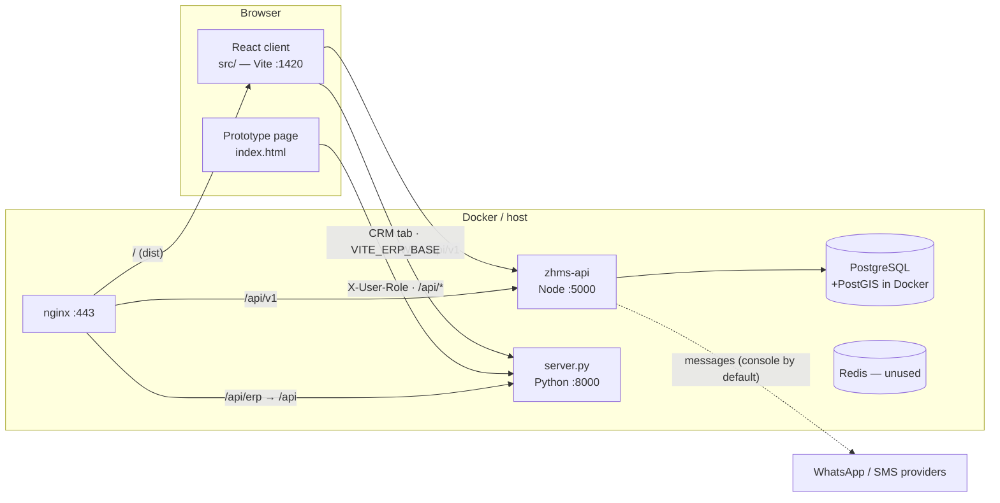
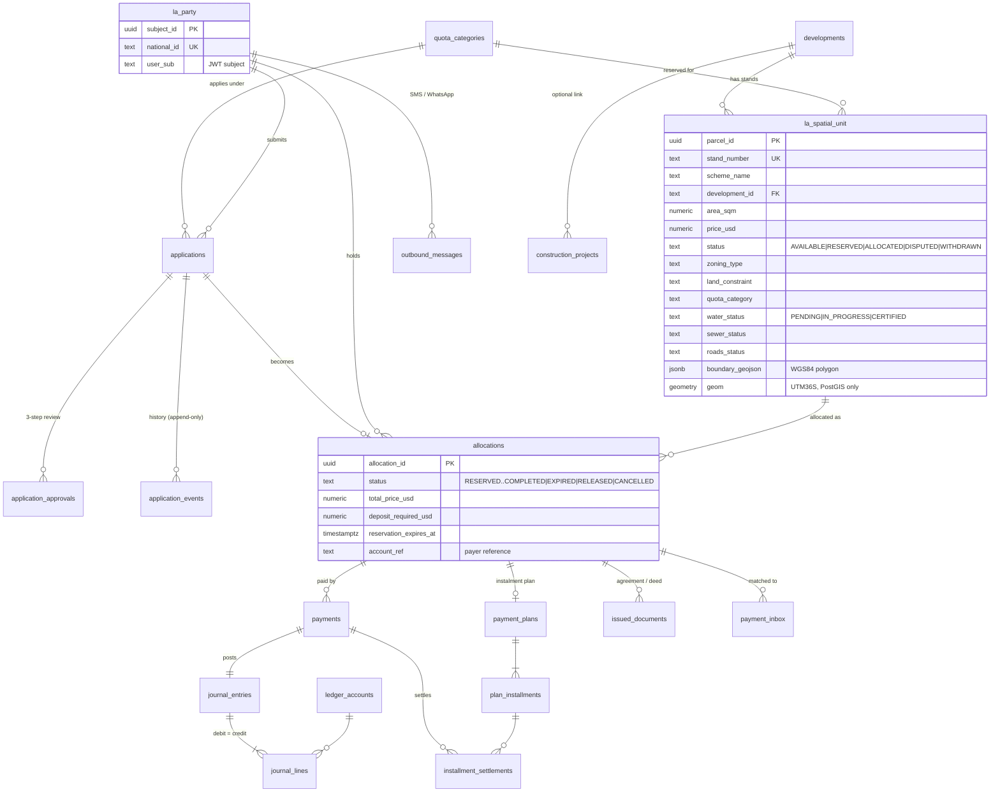

# Architecture

*Step 0 study, 2026-10-13. Describes the code as it is, not as planned.*

## 1. Tech stack and versions

| Layer | ZHMS core (system of record) | Prototype ERP |
|---|---|---|
| Language / runtime | JavaScript (ESM), Node ≥ 20 (dev machine: Node 24.14) | Python 3.11 |
| Web framework | Express 4.19 + helmet, cors, express-rate-limit | `http.server` (standard library); an unmounted FastAPI app in `src/real_estate_erp` |
| Database | PostgreSQL (dev: 18.3, Windows, **no PostGIS**; Docker: `postgis/postgis:16-3.4`) via `pg` 8, raw SQL, no ORM | none — in-memory objects |
| Validation | hand-written parsers (`fields.js`, `money.js`); `zod` is installed but unused | pydantic schemas (real_estate_erp only) |
| Auth | JWT HS256 (`jsonwebtoken`), issuer `zimbuild`, audience `zhms` | `X-User-Role` header (unverified) |
| Frontend | React 18.2 + TypeScript 5 + Vite 5 + Tailwind 3 + Leaflet 1.9 + lucide-react; Tauri 2 desktop shell | single generated `index.html`, vanilla JS, Tailwind/Leaflet/Font Awesome from CDNs |
| GIS libraries | Leaflet (client); own polygon maths in `gisService.js`; PostGIS (when available) | shapely, pyproj (`spatial/transformer.py`, `real_estate_erp/services.py`) |
| Tests | `node:test` + `embedded-postgres` (real PostgreSQL per test file) | pytest |
| Packaging | Docker Compose (postgres, redis, zhms-api, zhms-erp-python, nginx); GitHub Actions security gate | same compose file |

## 2. Folder structure

```
/                         repo root (one git repo)
├─ zhms-api/              ZHMS core API (Node)
│  ├─ migrations/         001–010 SQL migrations (applied in order on start-up, advisory-locked)
│  ├─ src/                app.js (routes), server.js (wiring + scheduler), services, auth, errors, money/dates helpers
│  │  └─ constructionRoutes.js + jobCost/siteProgress/tender/quality/equipment services
│  ├─ scripts/            seed.js, seed-construction.js, issue-token.js, test.js (test orchestrator)
│  └─ tests/              unit/, db/, integration/
├─ src/                   React client (ZHMS) — plus unrelated Python packages, see below
│  ├─ App.tsx             one component, 12 tabs
│  ├─ api.ts / types.ts   the only HTTP client and shared types
│  ├─ components/map/     InteractiveLeafletMap, ServicingProgressBar
│  ├─ components/gis/     GeoJsonUploaderModal (GeoJSON + SG schedule import)
│  ├─ components/construction/   construction workspace
│  ├─ erp/, supply_chain/, inventory/, construction/, civil/, fintech/, security/   Python engines for server.py
│  ├─ real_estate_erp/    FastAPI + SQLAlchemy + Prisma (not wired up)
│  └─ frontend/index.html copy of the prototype page
├─ server.py              prototype API (91 routes) + static file server
├─ index.html             prototype page (generated) — currently also the Vite entry page
├─ build_full_enterprise_erp.py   generator for index.html (overwrites two other .py files with HTML)
├─ tools/                 scripts that patch the generator / server.py; security_gate.py
├─ spatial/, contracts/, config/, main.py   Python helpers (transformer, zoning validator, agreement generator)
├─ src-tauri/             Tauri desktop config
├─ docker-compose.yml, Dockerfile.python, nginx/nginx.conf
└─ tests/                 Python tests
```

## 3. Runtime topology



Notes: the React client's tiles come from external tile servers today (Esri, CARTO, OSM) — see Risks.
`server.py` also serves files from the repository root as static files, using a denylist (source extensions,
config files and source folders are blocked). Anything not on the list is served — including
`audit_events.jsonl` (the security event log) and `nginx/nginx.conf`.

## 4. Data model (ZHMS core, PostgreSQL)



Other tables: `app_config` (business parameters), `fx_rates`, `audit_log` (SHA-256 hash chain, verified by
`verify_audit_chain()`), `schema_migrations`, and the construction set from migration 010 (`construction_projects`,
`project_budget_lines`, `budget_adjustments`, `cost_entries`, `materials`, `equipment`, `maintenance_logs`,
`project_milestones`, `daily_site_reports`, `daily_progress_updates`, `subcontractors`, `tenders`, `tender_bids`,
`subcontracts`, `subcontract_variations`, `subcontract_claims`, `quality_inspections`, `non_conformances`).

Integrity is enforced in the database: partial unique indexes (one live allocation per stand and per person),
triggers (`assert_stand_available`, `sync_stand_status`, `allocation_guard`, `assert_title_gate`,
`assert_journal_balanced`, `forbid_mutation` on append-only tables) and CHECK constraints. Custom SQLSTATEs
`ZH001`–`ZH018` are mapped to API errors in `zhms-api/src/errors.js`.

**Geometry today:** `boundary_geojson` (WGS84 Polygon, validated in `analysePolygon`: closed ring, inside a
Zimbabwe bounding box, ≥ 20 m²) is the single source; with PostGIS, trigger `sync_stand_geom` derives
`geom geometry(Polygon, 32736)`. Centroid, area and dimensions are computed in JS with a local equirectangular
projection. There are no phases, no stand-geometry history and no tenant column.

## 5. API surface

ZHMS core — 40 routes under `/api/v1` plus 55 under `/api/v1/construction` and `GET /healthz`. Full list with
screens is in SYSTEM_UNDERSTANDING.md §4. Conventions:
- JSON in/out; errors `{ error: CODE, message, details? }`; database errors never leak SQL.
- `Authorization: Bearer <JWT>`; `requireRole(...)` per route; public routes: health, document verification,
  developments/stands map (holder names only for staff), public register, quota summary, instalment quote, youth
  registration, signed payment webhooks.
- Idempotency: `X-Idempotency-Key` on reservations; unique `(channel, external_reference)` on payments.
- Rate limits: global 200/min/IP plus stricter limiters on registration and verification.

Prototype — 91 routes under `/api/*` in `server.py` (`do_GET` / `do_POST` if-chains), JSON, role from
`X-User-Role`, per-IP sliding rate limit (`RATE_LIMIT_MAX`, default 500).

## 6. Authentication and authorisation

- **ZHMS core:** stateless JWT verified with a fixed algorithm (HS256), issuer and audience; roles filtered to
  known values. No login endpoint, no password store, no 2FA, no refresh tokens — an external identity provider is
  assumed. Strict RBAC: a role grants only its own endpoints; buyers can read only their own statements.
  Construction roles are deliberately excluded from `STAFF_ROLES` so they cannot see buyers' data.
- **Prototype:** any client sending `X-User-Role: ceo` is treated as the CEO; `security_guard.ROLE_PERMISSIONS`
  maps roles to actions. Transactions are HMAC-signed with `ZIMBUILD_HMAC_SECRET` for tamper evidence, which does not
  authenticate the caller.
- **Multi-tenancy:** none in either system — one company (ZimBuild) per installation.

## 7. How data flows from UI to database (ZHMS core)

Example — a buyer pays by EcoCash:

1. The gateway calls `POST /api/v1/webhooks/payments/ECOCASH` (or `/webhooks/adapters/ecocash`) with an HMAC
   signature over the raw body and a timestamp; `signature.js` rejects forged or stale requests.
2. `PaymentInboxService.receiveWebhook` stores the notification in `payment_inbox` (unique per channel + reference,
   so retries are duplicates) and looks up the allocation by the buyer's `account_ref`.
3. If it matches, `PaymentService.recordPaymentWith` runs **in the same transaction**: locks the allocation, inserts
   the payment, posts a balanced journal, settles instalments oldest-first, moves the allocation status
   (e.g. RESERVED → AWAITING_SIGNATURE when the deposit is reached), queues a receipt in `outbound_messages`, and
   appends an audit block (always last, advisory-locked).
4. Database triggers keep the stand's status in step with the allocation.
5. The dispatcher (every 30 s) sends queued messages through the configured provider (console by default) with
   back-off; the scheduler (every `JOB_INTERVAL_MINUTES`) expires reservations, marks overdue instalments, queues
   reminders and monthly statements.
6. The React client reads the new state through `api.ts` (no polling or WebSockets — data refreshes when the user
   changes tab or presses refresh).

## 8. Configuration

`zhms-api/.env.example` documents every setting. Required: `DATABASE_URL`, `JWT_SECRET` (≥ 32 chars). Optional:
`PORT`, `CORS_ORIGINS` (required in production), `WEBHOOK_SECRET_<CHANNEL>`, messaging providers,
`JOB_INTERVAL_MINUTES`, `ZHMS_SPATIAL=0` (skip PostGIS migrations), `ZW_ID_CHECKSUM`, `ENABLE_PAYMENT_SIMULATOR`
(forbidden in production). Client: `VITE_API_BASE`, `VITE_ERP_BASE`. Prototype: `PORT`, `RATE_LIMIT_MAX`,
`ZIMBUILD_HMAC_SECRET`. The configuration loader refuses to start on missing or weak values.

## 9. How it is started, built and deployed

| Task | Command |
|---|---|
| API (dev) | `npm run server` (applies migrations on start) |
| Seed demo data | `npm run seed:api`, `npm run seed:construction` |
| Test token | `npm --prefix zhms-api run issue-token -- <sub> <ROLE,ROLE>` |
| Client (dev) | `npm run dev` → :1420 (**currently serves the prototype page**) |
| API tests | `npm run test:api` (embedded PostgreSQL, no install needed) |
| Prototype | `python server.py` → :8000; tests `python -m pytest tests` (reuses a server already on :8000) |
| Desktop app | `npm run tauri` |
| Production | `docker compose up` (postgres+PostGIS, redis, zhms-api, python ERP, nginx with TLS certs in `nginx/ssl`) |
